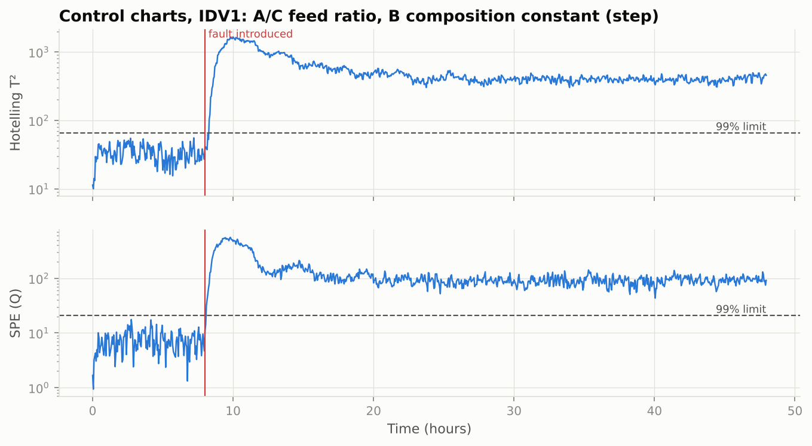
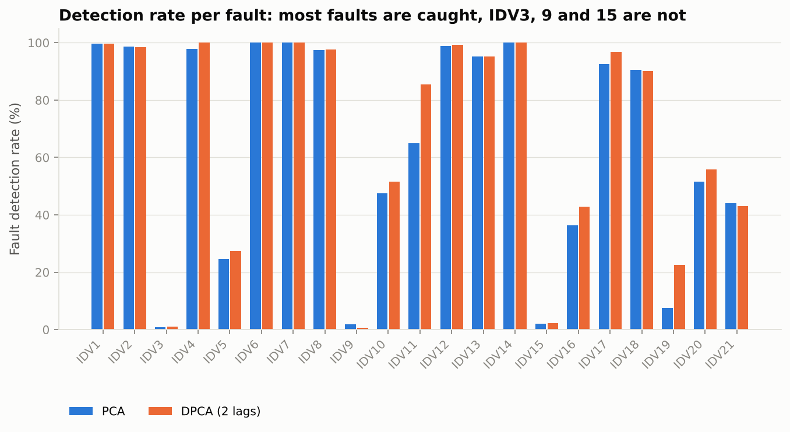
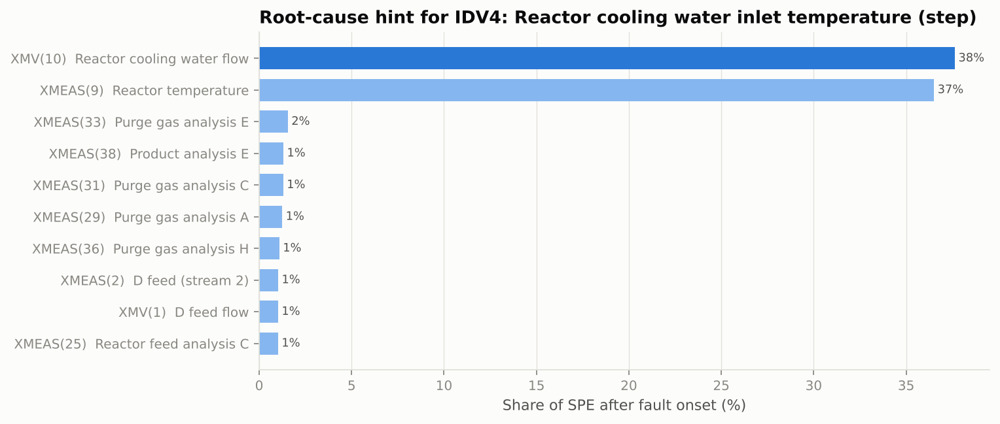
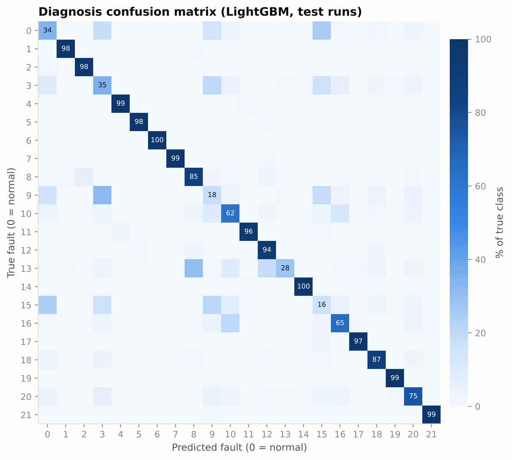

# Fault Detection & Diagnosis in a Chemical Process

[](https://github.com/c4r0l13/tep-fault-detection/actions/workflows/ci.yml)


Statistical process monitoring and machine learning on the **Tennessee Eastman Process (TEP)**, the standard benchmark for fault detection in chemical plants: 52 sensors and manipulated variables, 21 process faults, 3-minute sampling.

The project answers the three questions an operations team actually asks when something goes wrong in a plant:

| Question | Method | Headline result |
|---|---|---|
| **Is something wrong?** (detection) | PCA / Dynamic PCA with Hotelling T² and SPE control charts | 11 of 21 faults detected >90% of the time at a **0.3% false-alarm rate** |
| **Where is it coming from?** (isolation) | SPE contribution analysis | For IDV4, the two top variables are exactly the physical cause: reactor cooling water flow and reactor temperature |
| **Which fault is it?** (diagnosis) | LightGBM on sliding-window features | **0.84 macro-F1** across 19 classes (0.75 with all 22) vs 0.46 for a linear baseline |



---

## Key findings

**1. Textbook control limits produce an unusable alarm system.** The theoretical T²/SPE limits (F-distribution and Jackson–Mudholkar) assume independent Gaussian samples. TEP signals are autocorrelated and the normal training run has only 500 samples, so those limits fired on **14% of normal samples**. That inflates reported detection rates: a detector that alarms all the time "detects" everything. Calibrating the limits as empirical quantiles on an *independent* normal run brought the false-alarm rate down to **0.3%**, and every number below is reported at that operating point.

| Detector | Mean detection rate | False-alarm rate | Faults detected >90% | Median delay* |
|---|---:|---:|---:|---:|
| PCA, theoretical limits | 77.2% | 14.1% ⚠️ | 11 | 24 min |
| **PCA, calibrated limits** | 64.4% | **0.3%** | 11 | 33 min |
| **DPCA (2 lags), calibrated** | **67.1%** | 0.6% | 11 | 40.5 min |

<sub>*Time from fault onset until 6 consecutive alarms (an anti-chattering rule common in alarm management). False alarms are measured on the pre-fault portion of the 21 test runs, which are never used for fitting or calibration.</sub>

**2. Some faults are invisible to any unsupervised monitor — and that is the expected answer.** IDV3, IDV9 and IDV15 stay below 3% detection. The process control loops compensate those disturbances so well that the measured variables barely move. This matches the literature, where these three are often excluded from benchmarks; here they are kept and reported.



**3. Dynamic PCA helps on slow, random-variation faults.** Adding two time lags lifts IDV11 (reactor cooling water random variation) from 65% to 86% and IDV19 from 8% to 23%, because these faults change the *dynamics* of the signals rather than their mean level.

**4. Contribution plots recover the physics.** For IDV4 (step in reactor cooling-water inlet temperature) the SPE contributions point to the cooling-water flow controller XMV(10) reacting to the disturbance and the reactor temperature XMEAS(9) it is protecting. That is exactly what a process engineer would check first, and it is what makes the alarm actionable.



**5. Supervised diagnosis works when faults have a signature, and window features are what create it.** Rolling mean and standard deviation over 30 minutes let the classifier see variance changes (sticking valves, random variations) that a single snapshot cannot. LightGBM reaches ≥94% recall on 11 of 21 faults. Its weak spots are the same "invisible" faults and the normal class: normal operation gets confused with IDV3/9/15, which is the honest consequence of finding #2.



| Model | Accuracy | Macro-F1 (22 classes) | Macro-F1 (excl. IDV3/9/15) |
|---|---:|---:|---:|
| Logistic regression, raw snapshot | 0.383 | 0.412 | 0.462 |
| **LightGBM, window features** | **0.694** | **0.751** | **0.844** |

Full per-fault tables: [`reports/results.md`](reports/results.md).

---

## Approach

```
normal run (d00) ──► standardize ──► PCA (90% variance) ──► T² & SPE ──► limits calibrated on an independent normal run
                                     └─ DPCA: [xₜ, xₜ₋₁, xₜ₋₂]                        │
fault test runs (d01–d21) ─────────────────────────────────────────────────────────────┴─► alarms ─► FDR, FAR, delay
                                                                                               └──► SPE contributions ─► root cause

all training runs ──► rolling mean/std (window = 10) ──► LightGBM ──► fault class
```

Design decisions worth calling out:

- **No leakage between runs.** Lagged and rolling features are computed inside each simulation run, so the first samples of one run never see the end of another.
- **Calibration data ≠ evaluation data.** Limits are tuned on `d00_te`. False alarms are evaluated on the 3,360 pre-fault samples of the fault runs, which are separate simulations.
- **The confirmed-alarm rule is reported separately from raw detection.** Detection rate measures sensitivity; detection delay with 6 consecutive alarms is what an operator would experience.

## Project structure

```
tep-fault-detection/
├── src/tep_fdd/
│   ├── data.py          # loaders, variable & fault metadata
│   ├── monitoring.py    # PCA/DPCA monitor: T², SPE, limits, calibration, contributions
│   ├── metrics.py       # detection rate, false-alarm rate, detection delay
│   ├── diagnosis.py     # window features + classifiers
│   ├── pipeline.py      # end-to-end experiment → reports/
│   └── style.py         # figure style (colorblind-checked palette)
├── tests/               # unit tests (synthetic data, run in CI)
├── scripts/download_data.py
├── reports/             # metrics.json, results.md, figures/
├── Makefile
└── pyproject.toml
```

## Reproduce

```bash
git clone https://github.com/c4r0l13/tep-fault-detection.git
cd tep-fault-detection
python -m venv .venv && source .venv/bin/activate
make install   # pip install -e ".[dev]"
make data      # downloads the 44 .dat files (~25 MB)
make run       # ~2 min on a laptop; regenerates reports/
make test
```

## Limitations and next steps

- **One normal training run.** 500 samples is small for 52 variables (and 156 for DPCA). The Rieth et al. (2017) extended TEP dataset, with thousands of runs, would allow a proper validation split and deep models.
- **Linear monitor.** Kernel PCA or an autoencoder could catch the non-linear faults where both PCA variants stay below 60% (IDV5, 10, 16, 19, 20, 21).
- **Diagnosis assumes known faults.** In a real plant, new faults appear; an open-set approach (detect with PCA, classify only when confident) is the natural production design.

## Data and references

- Data: Braatz group TEP simulation, mirrored at [camaramm/tennessee-eastman-profBraatz](https://github.com/camaramm/tennessee-eastman-profBraatz).
- Downs, J. J., & Vogel, E. F. (1993). A plant-wide industrial process control problem. *Computers & Chemical Engineering*.
- Chiang, L. H., Russell, E. L., & Braatz, R. D. (2001). *Fault Detection and Diagnosis in Industrial Systems*. Springer.
- Ku, W., Storer, R. H., & Georgakis, C. (1995). Disturbance detection and isolation by dynamic PCA. *Chemometrics and Intelligent Laboratory Systems*.
- Jackson, J. E., & Mudholkar, G. S. (1979). Control procedures for residuals associated with PCA. *Technometrics*.
